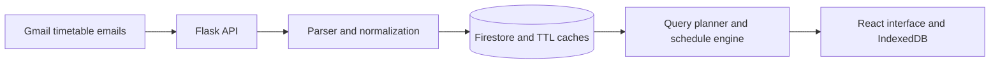

# ClassWire — SZABIST Islamabad Timetable & ZABDESK Schedule Search

> A natural-language SZABIST Islamabad timetable search and ZABDESK schedule companion for classes, courses, sections, faculty availability, and clash-aware planning.

[](https://szabist-islamabad-search.vercel.app/)
[](#project-status)
[](https://github.com/muneeb-anjum0/ClassWire-SZABIST-ISB/actions/workflows/security.yml)
[](LICENSE)

**Live:** [szabist-islamabad-search.vercel.app](https://szabist-islamabad-search.vercel.app/)

ClassWire converts SZABIST Islamabad timetable emails into searchable schedules and provides a focused companion to ZABDESK timetable workflows. Students can search SZABIST ISB sections, courses, faculty free slots, credit hours, and cross-section schedules while automatically detecting intentional timetable clashes—without a paid language-model request for every search.

ClassWire is an independent student project and is not an official SZABIST service.

## Project status

**Completed.** The planned product, search engine, data pipeline, responsive interface, security controls, performance work, and automated quality suite are implemented. The repository is now in maintenance mode for compatibility, timetable-format, security, and reliability updates.

## What ClassWire does

- Connects to the user's SZABIST Gmail account with read-only OAuth access.
- Selects the newest available timetable email independently for each weekday.
- Parses inconsistent HTML and plain-text timetable formats into normalized rows.
- Searches sections, courses, codes, faculty, weekdays, class types, and credit hours.
- Calculates faculty free time within university hours.
- Builds custom schedules from a base section, exact cross-section additions, and explicit exclusions.
- Infers course-section relationships from sentence structure instead of requiring fixed command wording.
- Detects timetable clashes only for intentionally composed custom schedules.
- Restores the latest successful result from IndexedDB across visits.
- Answers new questions from the fresh per-account browser timetable without waking Render.
- Syncs recent searches to the signed-in account across devices.
- Reuses each parsed weekday for seven days, refreshing and comparing only stale days.
- Supports optional scheduled daily timetable delivery.

Example questions:

```text
Show BSSE7A classes on Wednesday
When are Zainab Iftikhar and Hamza Imran free on Monday?
Show all 2-credit-hour theory courses
I am from BSSE7A; add Software Construction from BSSE5B
Take every BSSE7A class except Software Re-Engineering, plus SEC 3604 from BSSE5B
```

## Engineering snapshot

| Area | Result |
| --- | --- |
| Backend import | Approximately **0.19 seconds** on the measured development machine |
| Initial JavaScript | Reduced from **300.9 kB / 96.7 kB gzip** to approximately **205.1 kB / 65.4 kB gzip** |
| Large-result rendering | Initial work limited to **60 schedule rows**, then expanded progressively |
| Semantic planning | **1.17 ms mean**, **2.73 ms p95** across 2,000 warm local fixture queries |
| Automated checks | **248 backend tests + 73 frontend tests = 321 tests** |
| Measured coverage | **64.2% backend branch-aware coverage**, **76.0% frontend line coverage** |
| Search architecture | Structural intent inference, inspectable semantic plans, and parser-versioned caching |
| Optional NLU pipeline | TinyBERT intent and entity training, held-out evaluation, INT8 ONNX export, and CPU gates |
| Storage | Compressed Firestore documents, stable hashes, TTL caches, and write suppression |

Measurements are local engineering baselines. They do not represent public-network latency, Google API response time, Firestore latency, or Render free-tier cold starts.

## Architecture



The browser never receives Gmail OAuth credentials and never connects directly to Firestore. Authentication, ingestion, parsing, persistence, search, availability calculation, and automation remain behind the API.

## Documentation

| Document | Contents |
| --- | --- |
| [Documentation index](docs/README.md) | Complete technical documentation map |
| [Architecture](docs/architecture/README.md) | Components, request lifecycle, security, and repository structure |
| [Data pipeline](docs/data-pipeline/README.md) | Gmail synchronization, parsing, normalization, Firestore, and retention |
| [Search engine](docs/search-engine/README.md) | Entity recognition, query plans, schedule composition, availability, and clashes |
| [NLU training pipeline](ml/query_understanding/README.md) | Kaggle training, labeled data, evaluation, ONNX export, and deployment gates |
| [Performance](docs/performance/README.md) | Startup, caching, rendering, payload, and database optimizations |
| [Interface](docs/interface/README.md) | Search experience, responsive timetable presentation, accessibility, and SEO |
| [Operations](docs/operations/README.md) | Deployment, telemetry, background delivery, reliability, and cost visibility |
| [Quality suite](docs/quality/README.md) | Test organization, coverage policy, commands, and CI guarantees |

## Technology

React 19, TypeScript, Vite, Flask, Gunicorn, Cloud Firestore, Gmail API, Google OAuth 2.0, Beautiful Soup, IndexedDB, TinyBERT, ONNX Runtime, Pytest, Vitest, GitHub Actions, Vercel, Kaggle, and Render.

## Restricted license

ClassWire is publicly viewable but **not open source**. No permission is granted to copy, reuse, modify, distribute, deploy, sell, sublicense, or create derivative works from its source code, interface, documentation, branding, or implementation without prior written authorization.

The product concept and workflows are also not offered for reuse. Applicable law may distinguish an abstract idea from its protected expression and implementation. The enforceable restrictions are defined in the [ClassWire Restricted Source License](LICENSE).

Copyright © 2026 Muneeb Anjum. All rights reserved.
